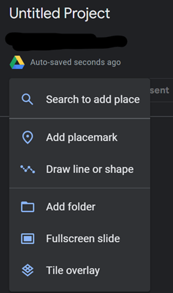

# Making Exercise Four: Map

## Think: Map

This week, we'll be working with maps and thinking through another relationship between the digital and the material, as mediated by the metadata of geography. Maps always make arguments: about what matters, who belongs where, and whose histories are visible. Projects like *Visualizing Emancipation* and *Mapping Inequality* show how layering data onto place can surface violence and injustice that official records obscure, while the "Disney Death Tour" shows how a map can be a playful, critical tour of a space we think we already know.

This week's featured interview with Lai-Tze Fan is available in Webcourses.

With the mainstream application (and reliance on) GPS technology, most of us already spend a lot of time looking at digital maps. You might even have engaged in some annotation, particularly if you’ve saved favorites or mapped out a road trip in advance. While once GPS devices were reserved for hikers and others engaged in more serious exploration, now we are often carrying multiples on our person—even as I write this, I’m wearing a GPS-capable watch and sitting next to a GPS-capable phone that are broadcasting my location most of the time. You can also imagine other ways to use spatial storytelling by looking at alternative making, such as the explorable XKCD comic [Click and Drag](https://xkcd-map.rent-a-geek.de/#10/1.1000/0.2000).

## The Map Prompt

Since we’re so familiar with this technology, it feels like a more accessible interface for one of our first patterns engaging in the digital: as you explore map-making, the emphasis will not be on coding, although more advanced forms of this work have the potential to delve into more complexity. The coding is nearly all done for the user, behind a what-you-see-is-what-you-get (WYSIWYG) interface. The process of creating a Google Earth project is more interface-driven than many of the other patterns we'll try; as with all critical making projects, the key here is to create the map around a coherent, informed critique. This pattern is thus an opportunity to think about spatial visualizations using a constrained interface for telling map-driven stories. As you map, think about:

- **Focus on spatial specificity and structure.** Your map will work best with a concrete connection to locations, whether that’s on a smaller scale like Joyce’s Dublin, or a larger scale like a war history visualization. In some cases, you might be mapping the fictional on to the “real” history or the historical onto landscapes that have changed vastly, and that juxtaposition can add to the meaning.

- **Try telling a story.** As the examples in this week's readings highlight, one of the distinctions between a critically-constructed map layer and a more basic information visualization about a location comes through in the intention. The slide-like structures map layering offer are also well-suited to organizing a narrative, and thus conveying an argument.

- **Explore image-text possibilities.** Google Earth embeds several options for juxtaposing visuals and texts: think about using those elements not just for description but for communication, persuasion, and critique. As maps are themselves a form of image-text, consider how your layering is in line with comics and other image-texts.

## Building Your Map in Google Earth

1. Go to [earth.google.com](https://earth.google.com/) and sign in with a Google account: logging in stores your project in Google Drive for sharing and changes later, just like other Google services.
2. Open the **Projects** panel, select **New project**, and choose to create it in Google Drive. Give it a title that signals your critical intention.
3. Add a **new feature** to start building your map. You can choose a placemark, a line or shape, a folder, a full-screen slide, or a title overlay (shown below). Placemarks and slides can each hold text, images, and links.
4. Arrange your features in the order you want a reader to encounter them, and use the project's **Present** option to preview your map as a guided story.
5. When you're ready to share, select **Share**, and under "General access" change **Restricted** to **Anyone with the link** before copying the link.

From there, the map can be used to display information about various locations—highlighting the similarities, differences, and more between the various locations, as informed by your research and engagement. However, it works best as a space for commentary and even reflection on the journey you are taking here. Remember, your map must be interactive, and it must contain a critical making statement that calls attention to, questions, critiques, or celebrates some larger aspect of humanity. You might find it helpful to experiment with the options around drawing lines and shapes and adding multimodal content, which are [well-documented in Google's overview of the tool](https://www.google.com/earth/outreach/learn/create-a-map-or-story-in-google-earth-web/).

Expect to be frustrated by some of the limitations of the tool: working within constrained interfaces and platforms can limit our expressive potential, but it also helps guide the making and provides limitations that can prevent the possibility space of the entire world from becoming too overwhelming to proceed. This is a particularly good exercise for narrowing your scope and thinking thoughtfully about what is necessary to communicate your intentions—practice that will serve you well in our next pattern, hypertext, which similarly pushes us into path-making that can lead in many directions.

## Augmenting with AI

Now that you've tried the traditional approach to making an interactive map, it is time to start working with the AI tool I'll be recommending for augmenting most of our digital work this semester, [Claude](https://claude.ai/). If you prefer not to get an Anthropic account for this class, you can use the [UCF Copilot](https://ai.ucf.edu/) subscription and select one of Claude's models, but note that it will be a bit more frustrating to work with, as it won't be able to build and share interactive artifacts the same way. Here's how to approach it:

1. Start a new chat at [claude.ai](https://claude.ai/) and ask for a web-based interactive map displaying some of the same information you embedded in your Google Earth project. Be as descriptive as possible: name your locations, describe what should appear when a reader clicks on each one, and include any additional elements you wished Google Earth could do.
2. Claude will build the map as an **artifact**, an interactive preview that appears alongside the chat. Try it out: click the markers, read the popups, and check the facts. AI tools can confidently misplace locations or invent details, so verify everything against your own research.
3. Ask for revisions in plain language ("make the markers color-coded by decade," "add a timeline slider," "the second location is wrong, it should be...") and notice what is easy to change and what resists.
4. When you're done, use the artifact's **Publish** option to get a shareable link (or take screenshots if you're using Copilot).

Compare the two ways of working: what did each make easy, and what did each make difficult or invisible?

As an example, I gave Claude the prompt "create an interactive map artifact displaying all the historical locations of significant feminist periodicals in the US" and it produced [this artifact](https://claude.ai/public/artifacts/f5957a70-ffcd-45c7-bd23-6bb1397a0f39).

### Discussion

Share your completed maps, following the pattern above. Your post should include:

- **Process documentation (3 points):** approximately five images or screenshots from different stages of your making, a link to your final Google Earth map, and your AI-augmented version (a link or screenshots), with a short narrative that walks through your thinking and compares the two ways of working.
- **Engagement with the readings (2 points):** connections to the readings and examples, including citations of at least two works from this module.
- **Peer responses (2 points):** at least two thoughtful replies to your peers' work.

**A note on sharing:** make sure you paste the "anyone can view" version of your Google Earth link (just like Google Docs: click **Share**, and then under "General access" change **Restricted** to **Anyone with the link**). Similarly, if you made a Claude artifact, select **Publish** and share that link. If you're using Copilot, or can't get artifacts to work, just share screenshots this week!

Remember, each week's discussion stays open for no-penalty late submissions and further conversation for one week after the deadline. After that, it closes for both submissions and replies.
