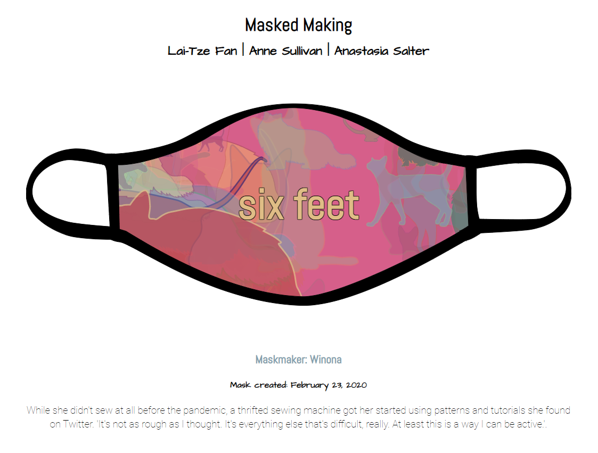

# Making Exercise Seven: Grammar

## Think: Grammar

This week, we'll be working with Tracery. Some of you might have already encountered Tracery, which was created by Kate Compton and offers us an entry point into the complicated world of procedural generation: text (and images) assembled by rules rather than written line by line. Generators, bots, and "infinite" texts like Mark Sample's catalog are a long-standing form of electronic literature, and they ask useful questions about authorship and scale long before large language models arrived. We'll be connecting our play to *Your Computer is On Fire*: I hope you find its provocations inspiring for thinking about your future work, and about the "fires" your own research is shaped by.

This week's featured interview with Kavi Duvvoori is available in Webcourses. You can learn more about their work on [their website](https://titleduntitled.name/) and through [*Taper*](https://taper.badquar.to/), a literary magazine for small computational works.

As we look towards the role of computational tools in making things visible and in_visible, we are going to gradually expand our procedural literacy. So far, we've focused on adding dynamic elements (looping, choice, and interactions) to our making: this week, we will concentrate on the *variable* using [Tracery](https://tracery.io/), a grammar for procedural text generation created by Kate Compton. If you'd like to hear from Compton directly, her [talk on Tracery](https://www.youtube.com/watch?v=isB82kORimk) is highly recommended.

## Learning Tracery

Before you can begin this assignment, it is important to understand the basics of JSON and Tracery. I suggest starting on this [nicely scaffolded practice website](https://tracery.io/archival/crystalcodepalace/tracerytut.html), which walks you through the basics of JSON and Tracery and was also created by Kate Compton. Note that this goes into much more depth than we need this week, but we will have opportunities to use Tracery again. This site provides seven rows of short examples of different grammars and rules. The left column includes an explanation in plain English about the grammar or rule, the middle column on each row has a small sandbox area for you to modify and experiment with different code, and to the right of each sandbox is posted a preview of what that coded part would produce. The first coding example is text generation, with simple lists of replacement text options for one symbol:

- "animal": ["unicorn","raven","sparrow","scorpion","coyote","eagle","owl","lizard","zebra","duck","kitten"]

Focus on symbols and sentence structure for now. Here's the whole idea in five steps:

1. **A grammar is a set of symbols.** Each symbol has a name (in quotes), followed by a colon and a list of options in square brackets. The whole grammar sits inside curly braces, with a comma between each symbol:

   ```json
   {
     "origin": ["The #adjective# #subject# #verb# the #place#."],
     "adjective": ["burning", "flooded", "unplugged", "overclocked"],
     "subject": ["raven", "server", "scholar", "archive"],
     "verb": ["haunts", "indexes", "abandons", "remembers"],
     "place": ["data center", "library", "group chat", "cloud"]
   }
   ```

2. **Generation starts at "origin."** Tracery reads the origin, and every time it finds a symbol name wrapped in hashtags (like `#subject#`), it swaps in a random option from that symbol's list. Options can contain more symbols, so sentences can nest inside sentences.
3. **Modifiers handle grammar for you.** Add `.capitalize`, `.a` (adds "a" or "an"), `.s` (plural), or `.ed` (past tense) inside the hashtags: `#subject.a.capitalize#` might produce "An archive."
4. **Variables keep choices consistent.** An action in square brackets saves a choice so you can reuse it: `"origin": ["[hero:#subject#]The #hero# left. Nobody missed the #hero#."]` uses the same subject both times.
5. **Test constantly.** One missing comma, quote, or bracket breaks the whole grammar. Paste your grammar into the [Tracery sandbox](https://tracery.io/archival/brightspiral/tracery/) to check it, and build up a few symbols at a time.

A few of you will have encountered Tracery before: if you have, I encourage you to try the suggestions for advanced users below, but they are not required! Note that this exercise asks you to respond specifically to the themes in the closing of our readings, and thus should require a very different type of grammar than you've made before if you used Tracery in the context of the Theory course.

## The Grammar Prompt

For this exercise, you will make and unleash a Tracery generator with an original grammar that puts your research and making in conversation with the provocations of *Your Computer is On Fire.* Your grammar should engage, either metaphorically or literally, with how your own research is shaped by the current "fires." Consider the examples of generative texts that demonstrate this type of engagement, from Mark Sample's [Infinite Catalog...](https://fugitivetexts.net/pandemicdreams/) to Clare Hooper's 2020 NaNoGenMo piece [Data of Death](https://github.com/NaNoGenMo/2020/issues/79). Your piece should:

- **Demonstrate a thoughtful range of grammar.** Try building on the model in the example first if you are new to generators, and incorporate a vocabulary appropriate to the type of making that drives your work. This is a great opportunity to play with language and consider the intersections of poetics, pragmatics, procedures, and play.

- **Expand upon at least three different rules.** Generate a dynamic range of content by employing multiple sentences, patterns, or syntax structures. Think about how you might invite someone to engage repeatedly with your grammar by crafting a meaningful generator of variety.

- **Be engageable in a space and context.** Launch your grammar using one of the two options below.

## Two Ways to Launch Your Grammar

**Option 1: Leonardo Flores's Generative Grammar Template.** Open Leonardo Flores's [Generative Grammar Template](https://iloveepoetry.org/creative/floresgenerativetemplate.html), save a copy of the page to your computer as an .html file, and open that file in a plain-text editor (such as VS Code, Notepad, or TextEdit in plain-text mode). Then make it your own:

1. Change the template's **colors** to suit your generator's mood.
2. Rewrite the **"origin"** statement to do something more interesting.
3. Change all of the **#variables#** (the Mad Libs-style blanks) and their **[variable definitions]**, replacing them with your own vocabulary.
4. Think about the grammar's structure and how you can produce interesting output, then save and open the file in your browser to test it. Refresh to generate again.

**Option 2: A Bluesky bot.** You can launch your grammar as a [Bluesky bot](https://bluebotsdonequick.com/): all you need is a separate Bluesky account for the bot. Sign in to the bot service with that account, paste in your grammar, and set how often it should post.

If you are an advanced user, you can also embed your grammar into your own .html file, as in my [retro-generative collaboration with Anne Sullivan](https://dalamar.neocities.org/) or [Masked Making](http://www.asdesigned.com/maskedmaking/), but this is not required. The course demo [Tracery in P5](materials/tracery.html) shows another approach: click anywhere to place a freshly generated line that drifts and fades. Its grammar lives in [mySketch.js](materials/mySketch.js) if you want to peek at how the pieces connect, and its companion [RiTa demo](materials/rita.html) generates rhymes with a different text library.

As with our other exercises, make sure to include both the .html file / link and your process reflection with screenshots from the process, drawing on the connections to our readings and considering the relationship your work has to a world of algorithmic content.

For advanced users, Tracery can be used for both visual and textual play, as demonstrated in the [Masked Making](http://www.asdesigned.com/maskedmaking/) generator, which uses both a textual grammar to create the imagined names of masked makers and their stories as well as a visual component to craft the masks themselves:



This is great practice for thinking about procedural generation and the construction of digital art, as well as the constructed nature of many web texts that invade our feeds and platforms.

## Resources for Experimenting

There are several options for those with more experience to consider for your future play in Tracery. Here's a few general resources on Tracery grammars and adding fun elements, such as emojis:

- [Tracery Live Demo - Adding emoji and dynamic elements](https://gregoryaveryweir.github.io/tracery-live/)
- [Tracery Continued - Adding action rules](https://catn.decontextualize.com/public/notebooks/propp-inspired-tracery.html)

One great option is to think about incorporating images - or even making memes, poetry, or comics, as in our previous experiments:

- [Blue Bots Done Quick](https://bluebotsdonequick.com/login) - an alternative option to HTML hosting
- [An example graphic bot](https://cheapbotsdonequick.com/source/hashfacade)
- [A reflection on bot process](https://harrygiles.org/2016/11/15/nabomamo-the-first-15-bots/)

Another fun option is to continue our exploration of remix by trying out Tracery with either Twine or Bitsy: you can find a Tracery integration in the Bitsy Hacks, and an [example walkthrough here](https://cephalopodunk.itch.io/silence-would-be-better/devlog/1802/bitsy-and-tracery-sitting-in-a-tree). For Twine and Tracery, take a look at our example in [P-4 of *Twining*](https://www.fulcrum.org/concern/monographs/ms35tb924), which includes an example with Tracery already integrated into the Twine structure. We'll be doing more intentional remixing in future exercises, so keep this in mind for the coming weeks even if you don't try it now!

### Discussion

Share your completed generator, following the pattern above. Your post should include:

- **Process documentation (3 points):** approximately five images or screenshots from your process, along with your final grammar in your .html file (or a link to your bot). If you are using the Generative Grammar Template, make sure you have:
  - changed the template's **colors**;
  - rewritten the **"origin"** statement to do something more interesting;
  - changed all of the **#variables#** (Mad Libs blanks) and **[variable definitions]**;
  - thought about the grammar structure and how you can produce interesting output.
- **Engagement with the readings (2 points):** connections to the readings and examples, including citations of at least two works from this module.
- **Peer responses (2 points):** at least two thoughtful replies to your peers' work.

Each week's discussion stays open for no-penalty late submissions and further conversation for at least one week after the deadline; because spring break follows soon after, this one stays open through the end of the break. After that, it closes for both submissions and replies.
