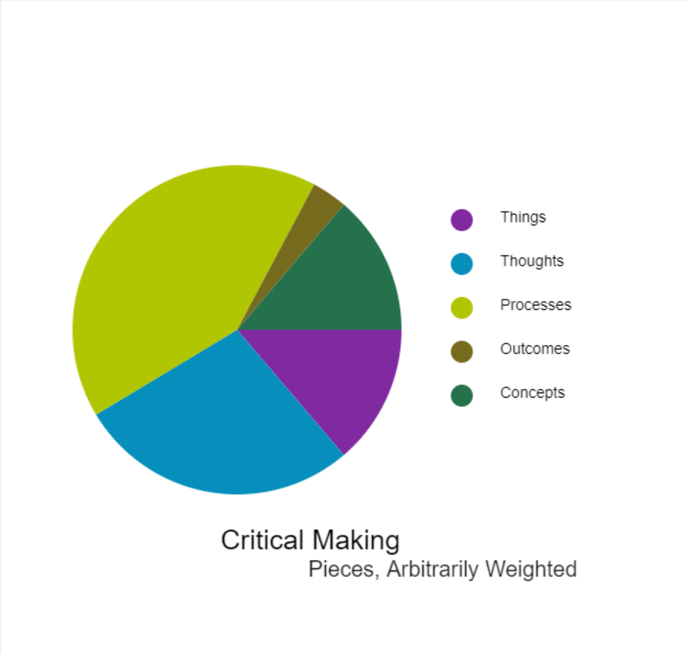

# Making Exercise Ten: Code

## Think: Code

This week, we'll be exploring computational creativity through code directly, using [P5.js](https://p5js.org/), a library for visual, interactive design for the web. P5 comes out of the "creative code" tradition: an approach to programming that treats code as an expressive, artistic medium and centers artists, designers, and beginners rather than professional software engineers. Last week, we let an agent write nearly everything; this week, we slow back down and get our hands on the code itself, asking what it means to read and write code in the age of AI. This is intended to be a shorter exercise, so following the steps below closely will help it go smoothly.

This week's featured interview with Zach Whalen is available in Webcourses. His [*Stepscapes*](https://editor.p5js.org/zachwhalen/sketches/-DDPke_bt), linked in this week's Explore list, is a lovely example of what a single P5 sketch can do.

The goal this week is to explore P5 directly, with AI for assistance in code and interpretation as you choose, in preparation for building a more complex agentic-driven project next week.

## The Code Prompt

Before the advent of AI as a meta-tool for low code development, critical making and digital humanities generally involved building code literacy. What is code literacy now, and how does becoming familiar with this way of organizing and thinking about making serve in the current context? We'll be exploring this at multiple levels during the next few weeks. For this exercise, try:

- **Build a simple sketch from "scratch."** Follow the walkthrough below, and try playing with static or interactive shapes, text, and colors. Don't worry about doing anything fancy - just try to get more confident authoring the code.

- **Change and play with the provided P5 structures.** Take screenshots or share links to your forked versions of the provided samples, noting how the limitations and structures of each design influenced what you chose to visualize. You can work from "real" data (numbers drawn from your research, your reading, or your life) or "conceptual" data (values that express a feeling, argument, or speculation rather than a measurement): both are legitimate, and the choice is itself part of your argument.

- **Explore other P5 examples on OpenProcessing or P5.js and "fork" them.** Use AI tools as desired to understand where and how you might change the existing code, and think about how you interpret and "read" the code given the tools that are now available.

As with our other exercises, make sure to include both a link to any digital elements as well as documentation of the process, including any usage of AI as an assistant for code debugging and interpretation.

## Walkthrough and Resources

The samples for this week are shared using [OpenProcessing](https://openprocessing.org/). This platform is free and lets us eliminate certain steps (like uploading to a web server or configuring the file system) so we can focus on playing with the library itself. The [P5.js web editor](https://editor.p5js.org/) works similarly, and you're welcome to use either, but it will be easier to fork the samples on OpenProcessing.

### Part One: A sketch from scratch

1. Create a free OpenProcessing account and select **Create a Sketch**. You'll see a code editor with a starter sketch.
2. Every P5 sketch has two main functions. `setup()` runs once, when the sketch starts; `draw()` runs over and over, many times a second. Replace the starter code with this:

   ```javascript
   function setup() {
     createCanvas(600, 400);
   }

   function draw() {
     background(30, 30, 60);          // red, green, blue (0-255)
     fill(255, 200, 0);               // the color of the next shape
     noStroke();
     ellipse(300, 200, 120, 120);     // x, y, width, height
     fill(255);
     textSize(24);
     text("Hello, critical making", 20, 40);
     fill(255, 0, 120);
     circle(mouseX, mouseY, 30);      // follows your mouse
   }
   ```

3. Press the play button to run it. Then change one thing at a time and run it again: the numbers in `background()` and `fill()` (use an [RGB color picker](https://www.rapidtables.com/web/color/RGB_Color.html) to find values), the position and size of the ellipse, the text itself. Try `rect(x, y, width, height)` or `line(x1, y1, x2, y2)`.
4. Try moving `background()` from `draw()` into `setup()` and run it again. What happens to the circle that follows your mouse, and why?
5. Save your sketch, give it a title, and copy its link for your post. If something breaks, read the error message in the console below the editor, undo your last change, or ask an AI assistant to explain the error (paste in both the code and the message).

The [P5.js reference](https://p5js.org/reference/) lists every function, with small examples you can copy and modify.

### Part Two: Fork the samples



"Forking" means making your own copy of someone else's sketch that you can change freely without affecting the original. To fork each sample:

1. Open the sketch link below and look at it running. Select the code view (the `</>` icon) to read the code, looking for comments (lines starting with `//`) and for the lists of numbers and words that hold the data.
2. Select **Fork** to make your own copy, which opens in the editor under your account.
3. Change the data, colors, and text strings to tell your own story, run it, and save. Each fork gets its own link.

- [Simple Bar Chart](https://openprocessing.org/sketch/1307584)
- [Pie Chart](https://openprocessing.org/sketch/1307661)
- [Text Click](https://openprocessing.org/sketch/1307624)

Remember that each stage of this exercise serves a different purpose: if you've never worked with a library like P5.js before, don't expect to realize the type of concept that you might be able to explore in another materiality. Focus on getting comfortable with the basic tools (forking and editing the code's data, color, and string inputs), and think about how that might help you approach a more complex project with AI tools next week.

### Discussion

Share your sketches, following the pattern above. Your post should include:

- **Process documentation (3 points):** approximately five images or screenshots from your process, including your sketch from scratch and your forked versions of the samples, with links to each, any use of AI for debugging or interpretation, and a short narrative that walks through your thinking.
- **Engagement with the readings (2 points):** connections to the readings and examples, including citations of at least two works from this module.
- **Peer responses (2 points):** at least two thoughtful replies to your peers' work.

Remember, each week's discussion stays open for no-penalty late submissions and further conversation for one week after the deadline. After that, it closes for both submissions and replies.
