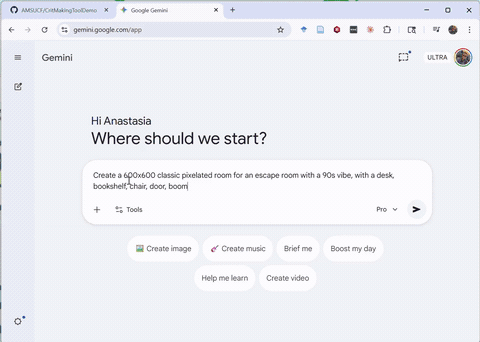

# Optional Making Exercise Thirteen: Tools

## Think: Futures

Welcome to the final week of classes! This week, we look toward the future: of your own making, of the tools we make with, and of how we teach and share these practices with others. Throughout the semester, we've relied on tools built and maintained by individuals and small communities, each of which embeds its makers' values about who should be able to create, and how. This week's readings on design pedagogies, along with works like Quinn Daedal's *Future Text* and Amy Goodchild's generative art, invite us to think about making as something we pass on.

This week's optional exercise is to build your own tool for simple making: perhaps something you think you'd use in the future, or just something fun you'd like to experiment with. It's also a chance to revisit previous tools and make connections between platforms and methods, so consider drawing upon the work you've enjoyed most so far this semester. As you finish the semester, also start thinking about your [Final Reflection](reflection).

We've been working with tools maintained by individuals and small teams throughout the semester, from Bitsy to Twine and Tracery. Think small and use Claude Code to develop a simple web interface that allows the user to "create" something within a genre.

## The Tools Prompt

This week's prompt is intentionally flexible and open to your creative and professional goals, so think about what might be useful to you in the future. As one example, I made a [tool](https://anastasiasalter.net/CritMakingToolDemo/) that allows the user to import an image and build a simple, one-room P5.js escape room. Here's a shortened walkthrough of the process behind this example:

Notice how this tool includes both a sample of it in action (built from a generated sample image, and customized directly by me using the tool itself) and an export function to allow the user to take their game and customize it further or share it on any platform. This is very far from the complexity of Bitsy, Twine, and Tracery, but it demonstrates how agentic AI works as a meta-tool, allowing us to build better interfaces for the specific work we want to do.

As you work on your tool, make sure to include:

- **Something the user can edit directly.** Remember that the value of the low-code and no-code tools we've used this semester lies in providing both freedom and constraints, so consider what you are going to control and where the user will be able to build something new with intention.

- **A sample outcome.** Without some example, it is difficult for a user to pick up a tool and know what it is useful for. You can start by generating the sample, but make sure to try customizing and building something directly with your own tool to see if it works.

- **Options for export.** In order to count as a "tool," the thing you produce must allow the user to build something and take it into other contexts. I recommend specifying that you are building a web interface that exports to HTML, but if you have something else in mind (a Python utility that builds a spreadsheet, etc.) feel free to do that instead - just host and share the code itself on GitHub so others can try it.

## Building Your Tool, Step by Step

1. **Define the genre and the constraint.** In a sentence or two, write down what your tool helps someone make (a one-room escape game, a blackout poem, a zine page, a generative quilt pattern) and what the user gets to control. Small and specific is better than ambitious and vague.
2. **Start a repository.** Create a new GitHub repository (as in [Making Exercise Nine](nine_generation)) and add a short `notes.md` file with your definition, plus any sample images or text you want the tool to use.
3. **Plan with Claude Code.** Open the repository in [Claude Code](https://claude.ai/code) and ask for a plan for a single-page web tool with three parts: an editing interface, a built-in sample, and an export button that downloads the user's creation as an HTML file. Revise the plan before any code is written.
4. **Build, then use it yourself.** Once it's built, publish it with GitHub Pages and make something with your own tool. Where were you frustrated? What did you wish you could control? Bring that back to Claude as feedback.
5. **Test the export.** Download something you made, open the file on its own, and make sure it works outside the tool.

As always, please share screenshots from your process as well as a link to your tool prototype on GitHub (either the repository or the working website, depending on what type of tool you make)!

### Discussion

*This exercise is optional extra credit: it can make up for a missed exercise, and it won't count against you if you choose not to complete it.*

Share your tool, following the pattern above. Your post should include:

- **Process documentation (5 points):** approximately five images or screenshots from your conversation and the objects created as part of the process, a link to your tool (the working website or the repository), and a short narrative that walks through your thinking.
- **Engagement with the readings (2 points):** connections to the readings and examples, including citations of at least two works from this module.

Peer replies are not required for this exercise, since it's optional and I don't know how many people will participate, but you're welcome to comment on each other's tools! This final exercise is due Sunday, May 2, at the close of the course, and no additional extensions are available.
